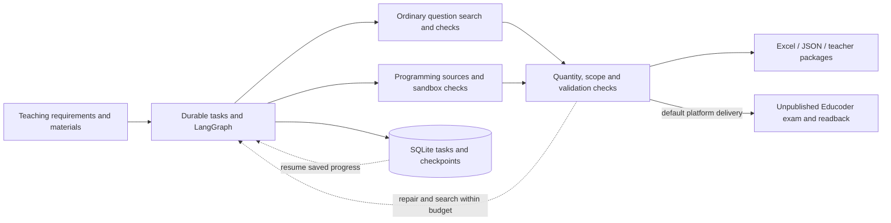

# CourseAgent

[简体中文](README.md) · English

**Turn teaching requirements and course materials into assignments with source references, executable checks and recoverable delivery.**

CourseAgent is a local LangGraph application that collects ordinary and programming questions in parallel, matches course scope, checks answers and runs reference programs in isolation. It exports Excel, JSON and teacher assessment packages. By default, it delivers to an unpublished Educoder exam and retains local files. Local generation without platform delivery is also available.

[Installation and usage](docs/quickstart.en.md) · [Architecture](docs/architecture.en.md) · [Evaluation](docs/evaluation.en.md) · [Development and publishing (Chinese)](CONTRIBUTING.md)

## Features

- **Task recovery:** persistent queues, heartbeat leases, LangGraph checkpoints and per-question validation caches.
- **Course matching:** parallel question collection, material scope checks, topic filtering and selection history.
- **Answer verification:** public-example checks and reference execution in a Linux sandbox to produce test data.
- **Platform delivery:** automatic Educoder import, programming test configuration and readback, alongside Excel, JSON and teacher packages.



Tasks and checkpoints persist in SQLite. Per-question caches reuse passed checks; content changes invalidate related validation records. Programming checks rely on source programs and finite examples, so teachers should review the result. [Architecture and recovery](docs/architecture.en.md).

## Quick start

Use Linux or Windows WSL2 with Python 3.11+. Run from the repository root:

```bash
python3 -m venv .venv
source .venv/bin/activate
python -m pip install -r requirements.lock.txt
python -m pip install --no-deps -e .
python -m scripts.demo
bash start.sh
```

Open <http://127.0.0.1:8765/>. The fixed demo requires no API key and writes example files to `outputs/demo/`.
Before real generation, copy `model-config.example.json` to `model-config.local.json` and configure your own model service.
See [installation and usage](docs/quickstart.en.md) for environment checks, sandbox setup and optional retrieval and browser dependencies.

Submit a request such as:

> Create an assignment on stacks and queues with four multiple-choice questions, four true/false questions and four programming questions. Include reference answers, public examples and hidden tests.

Enter the classroom exam-list URL and course name for default platform delivery. The saved exam remains unpublished until the teacher publishes it. Select local generation to produce files only. Text-based PDF and DOCX files can define course scope; see [setup](docs/quickstart.en.md#4-submit-a-real-request) for browser and login requirements.

## Evaluation

CourseAgent was evaluated on **20 requirements with three repetitions each, totaling 60 tasks and 876 question occurrences**:

| Metric | CourseAgent |
| --- | ---: |
| Experiment size | 20 requirements, 60 tasks, 876 question occurrences |
| Question completion rate | **97.26% (852/876)** |
| Complete assignment rate | **91.67% (55/60)** |

These rates measure generation completion. Question quality and platform save-and-readback outcomes are evaluated separately. See [evaluation](docs/evaluation.en.md) for the experimental setup, metric definitions and scoring rules, and [experiment records (Chinese)](evaluations/README.md) for aggregation details and source records.

## Project navigation

| Path | Contents |
| --- | --- |
| [src/courseagent/](src/courseagent/) | Python services, agent, retrieval and verification; `web/` contains the workbench, `browser/` the adapters |
| [tests/](tests/), [scripts/](scripts/) | Offline regressions, demos, evaluation and release utilities |
| [docs/quickstart.en.md](docs/quickstart.en.md) | Installation, configuration, usage and troubleshooting |
| [docs/architecture.en.md](docs/architecture.en.md) | Module responsibilities, recovery and execution boundaries |
| [docs/evaluation.en.md](docs/evaluation.en.md), [evaluations/](evaluations/README.md) | Analysis, scoring rules and sanitized records |
| [examples/](examples/) | Original offline inputs |

Directory conventions, test commands and GitHub publishing steps are maintained in [CONTRIBUTING.md](CONTRIBUTING.md).
Local configuration, data, outputs and browser sessions are Git-ignored.

## Scope and license

The application targets local, single-user operation and listens only on `127.0.0.1`. Finite checks and reference programs have limited coverage. Scanned PDFs, complex formulas and special judges for multiple valid answers have limited support; teachers should review generated assignments.

Original code and examples use the [MIT license](LICENSE). See [third-party notices](THIRD_PARTY_NOTICES.md) for attribution and content licensing, and [SECURITY.md](SECURITY.md) for runtime and data boundaries.
