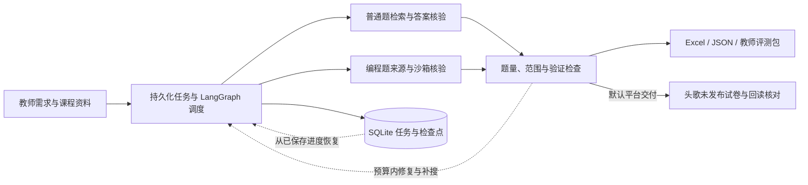

# CourseAgent

简体中文 · [English](README.en.md)

**把教师需求和课程资料，转成有来源、可核验、可恢复的课程作业。**

CourseAgent 是基于 LangGraph 的本地 Agent 应用。普通题与编程题并行搜集，结合课程范围匹配、答案核验和参考程序隔离执行，导出 Excel、JSON 与教师评测包。默认交付至头歌平台的未发布试卷，并保留本地文件；也可选择仅本地生成。

[安装与使用](docs/quickstart.md) · [系统架构](docs/architecture.md) · [实验评估](docs/evaluation.md) · [开发与发布](CONTRIBUTING.md)

## 主要能力

- **任务恢复**：持久化队列、心跳租约、LangGraph 检查点与逐题验证缓存。
- **课程匹配**：并行搜集普通题与编程题，按资料范围、考点与选题历史筛选。
- **答案核验**：核对公开样例，在 Linux 沙箱内执行参考程序并生成评测数据。
- **平台交付**：自动导入头歌、配置编程用例并回读核对，同时导出 Excel、JSON 和教师评测包。



任务与检查点存储于 SQLite，逐题阶段缓存复用已通过的验证结果；内容变化会使相关凭据失效。编程核验依赖来源程序和有限样例，最终内容仍需教师审阅。[架构与恢复机制](docs/architecture.md)。

## 快速开始

推荐 Linux 或 Windows WSL2，Python 3.11+。在仓库根目录执行：

```bash
python3 -m venv .venv
source .venv/bin/activate
python -m pip install -r requirements.lock.txt
python -m pip install --no-deps -e .
python -m scripts.demo
bash start.sh
```

打开 <http://127.0.0.1:8765/>。固定演示无需 API Key，在 `outputs/demo/` 生成示例文件。
真实搜题前，将 `model-config.example.json` 复制为 `model-config.local.json`，填写自己的模型服务。
环境检查、编程沙箱、可选检索与浏览器配置见[安装与使用](docs/quickstart.md)。

在页面提交需求，例如：

> 给数据结构课程布置一次关于栈和队列的作业，包含 4 道单选题、4 道判断题和 4 道编程题，提供参考答案、公开样例与隐藏评测数据。

填写课堂“在线考试”列表页地址和平台所属课程，默认完成平台保存与回读核对，之后由教师正式发布。可上传有文字层的 PDF 或 DOCX 作为课程范围；需要只生成文件时勾选“仅本地生成”。平台浏览器与登录准备见[安装与使用](docs/quickstart.md#4-提交真实需求)。

## 实验结果

CourseAgent 在 **20 个需求各运行 3 次，共 60 次任务、876 题次**的实验中，取得以下生成结果：

| 指标 | CourseAgent |
| --- | ---: |
| 实验规模 | 20 组需求，共 60 次任务、876 题次 |
| 题目完成率 | **97.26%（852/876）** |
| 整套任务完成率 | **91.67%（55/60）** |

以上完成率按生成结果统计；题目质量与平台保存回读分别评估。实验设置、指标定义与评分规则见[实验评估](docs/evaluation.md)，统计口径与原始记录见[实验记录](evaluations/)。

## 项目导航

| 位置 | 内容 |
| --- | --- |
| [src/courseagent/](src/courseagent/) | Python 服务、Agent、检索与核验；`web/` 为工作台，`browser/` 为适配器 |
| [tests/](tests/)、[scripts/](scripts/) | 离线回归、演示、评估和发布工具 |
| [docs/quickstart.md](docs/quickstart.md) | 环境安装、配置、使用与故障排查 |
| [docs/architecture.md](docs/architecture.md) | 模块职责、任务恢复与执行边界 |
| [docs/evaluation.md](docs/evaluation.md)、[evaluations/](evaluations/) | 实验分析、评分规则与脱敏数据 |
| [examples/](examples/) | 原创离线输入 |

目录约定、测试命令和 GitHub 发布步骤统一放在 [CONTRIBUTING.md](CONTRIBUTING.md)。
本地配置、数据、输出和浏览器会话均由 Git 忽略。

## 使用范围与许可

应用面向本地单用户，仅监听 `127.0.0.1`。有限样例与参考程序核验有适用范围，扫描 PDF、复杂公式和多答案特殊判题支持有限，最终作业需由教师审阅。

原创代码与示例采用 [MIT](LICENSE)。第三方代码和内容见[许可说明](THIRD_PARTY_NOTICES.md)，运行与数据边界见 [SECURITY.md](SECURITY.md)。
