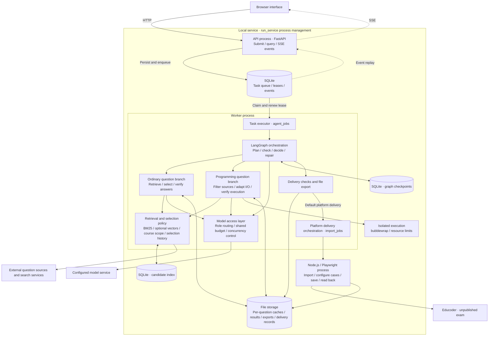

# System architecture

[简体中文](architecture.md) · English

CourseAgent runs locally on a single machine. FastAPI receives requests, an independent Worker executes the LangGraph workflow, and a persistent task queue connects the two processes. The workflow collects and verifies ordinary and programming questions in parallel. After assignment checks, its default delivery workflow sends the result to Educoder while retaining local exports. With local generation selected, the workflow ends after export.

## Components and deployment

The API and Worker run as separate processes. Graph nodes, retrieval and model access are modules inside the Worker. Browser adapters run through Node.js / Playwright, while reference programs execute in a separate sandbox. `run_service.py` starts and monitors the API and Worker and can restart exited child processes.

## Module responsibilities

| Layer | Main modules | Responsibilities and outputs |
| --- | --- | --- |
| API and task service | [api_service.py](../src/courseagent/api_service.py), [app.py](../src/courseagent/app.py) | Validate requirements and delivery targets; submit tasks, query status, download files and replay SSE events |
| Scheduling and execution | [task_store.py](../src/courseagent/task_store.py), [agent_worker.py](../src/courseagent/agent_worker.py), [agent_jobs.py](../src/courseagent/agent_jobs.py) | Enqueue and claim tasks, renew leases, coordinate execution, save progress and connect delivery |
| Agent orchestration | [autonomous_agent.py](../src/courseagent/autonomous_agent.py) | Route between search, adaptation, verification, repair, delivery and pause based on assignment state and checks |
| Ordinary questions | [workflow.py](../src/courseagent/workflow.py), [ordinary_web_search.py](../src/courseagent/ordinary_web_search.py), [ordinary_verification.py](../src/courseagent/ordinary_verification.py) | Parse requirements, retrieve candidates, match question types and scope, verify answers and assemble ordinary-question results |
| Programming questions | [programming_sourcing.py](../src/courseagent/programming_sourcing.py), [source_verification.py](../src/courseagent/source_verification.py), [programming_verification.py](../src/courseagent/programming_verification.py) | Check sources and reference programs, adapt standard input/output, verify examples and generate assessment data |
| Shared retrieval and selection | [retrieval_runtime.py](../src/courseagent/retrieval_runtime.py), [hybrid_retrieval.py](../src/courseagent/hybrid_retrieval.py), [selection_policy.py](../src/courseagent/selection_policy.py) | Candidate memory, keyword and optional vector retrieval, course-scope filtering and penalties for reuse across assignments |
| Model and execution resources | [model_client.py](../src/courseagent/model_client.py), [agent_roles.py](../src/courseagent/agent_roles.py), [native_sandbox.py](../src/courseagent/native_sandbox.py) | Coordinate model roles, budgets and concurrency; execute Python, C, C++ and Java reference programs in isolation |
| Platform delivery | [verification_tools.py](../src/courseagent/verification_tools.py), [import_jobs.py](../src/courseagent/import_jobs.py), [educoder_import.cjs](../src/courseagent/browser/educoder_import.cjs) | Create an unpublished exam, import questions, configure programming cases, save and verify by readback |

## Task data flow

1. **Submit requirements.** The interface sends course scope, question types, counts and materials. Platform mode also includes the classroom URL and course name. The API persists the task and input snapshot, then returns a task ID.
2. **Claim the task.** A Worker claims the task from SQLite and maintains its heartbeat lease. LangGraph converts the request into an assignment plan. Ordinary and programming branches collect and verify candidates in parallel, merging stage results into one assignment document.
3. **Select and verify.** Retrieval reuses candidate memory, uses BM25 and optional vectors to discover candidates, and filters by materials, primary topics and selection history. Ordinary-question answers are checked. Programming verification first checks source implementations against public examples, then constructs inputs and executes reference programs to generate expected outputs.
4. **Check the assignment.** Orchestration checks question types and counts, course coverage, required fields and verification results. Missing or problematic questions enter additional search, replacement or local repair within the budget. If completion is impossible, the system retains results and reports the blocker.
5. **Deliver results.** Passed checks lead to Excel, JSON and teacher assessment exports. The default delivery workflow then invokes the platform adapter to import and read back an unpublished exam. Local generation ends after export. The interface can retrieve task status, events and download links again later.

Model roles participate in planning and judgment through structured outputs. Tool interfaces use LangChain StructuredTool and Pydantic validation. A dedicated delivery module performs platform writes.

## State and storage

| Storage | Contents | Purpose |
| --- | --- | --- |
| `data/agent-tasks.sqlite` | Tasks, input snapshots, queue state, owners, leases and events | Communication between API and Worker; interface event replay |
| `data/agent-checkpoints.sqlite` | LangGraph checkpoints | Recover graph state and node progress |
| `data/retrieval.sqlite` | Candidate indexes and retrieval memory | Reuse candidates and reduce repeated discovery |
| `outputs/agent-tasks/<id>/` | Task results, per-question stage caches, Excel, JSON and assessment packages | Retain generated content, reuse completed verification and provide downloads |
| `outputs/import-jobs/<id>/` | Import state, platform URLs, configuration progress and readback records | Track platform delivery and check existing drafts |

The queue uses SQLite WAL and transactional claims. Writes check lease ownership to prevent an old Worker from overwriting results after losing its lease. The system limits concurrent autonomous tasks while allowing branches and model requests to run in parallel within a task.

[verification_state.py](../src/courseagent/verification_state.py) fingerprints the inputs to each per-question stage and saves caches through atomic file replacement. Changes to a statement, reference program or relevant dependency invalidate the corresponding verification result. Passed stages with unchanged inputs can be reused. Per-question caches and graph checkpoints are stored separately.

Interrupted generation can resume from saved state. Before platform operations, the system records delivery intent, then saves the import ID and execution result. If interruption occurs during a stage that may already have written to the platform, it checks the existing draft before deciding how to continue, avoiding duplicate creation. Persisted event cursors restore progress in the interface.

## Platform and execution boundaries

The default platform-delivery workflow creates, imports, saves and reads back an unpublished exam. The teacher performs final publication to students. `execute=false` selects local generation and bypasses platform delivery. Fixed demos and offline regressions explicitly use local execution or mocks.

Reference programs run inside Linux bubblewrap with read-only system paths, no workspace or user-directory mounts, and CPU, memory, process, file and output limits. Programming execution stops if the sandbox is unavailable. Source implementations and finite examples determine verification coverage. Special judges for multiple valid answers have limited support; teachers should review the final content.

The application listens only on `127.0.0.1` by default and targets local, single-user operation. See [installation and usage](quickstart.en.md) for setup, browser sessions and platform configuration, and [evaluation](evaluation.en.md) for experimental metrics.
