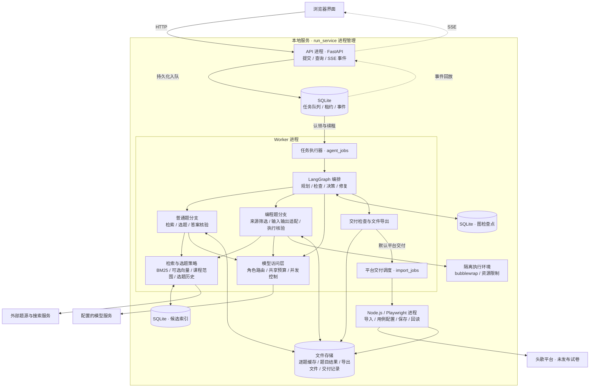

# 系统架构

CourseAgent 采用本地单机部署：FastAPI 接收请求，独立 Worker 执行 LangGraph 工作流，两者通过持久化任务队列通信。工作流内并行处理普通题与编程题，完成整卷检查后默认交付至头歌平台，同时保留本地导出文件；选择“仅本地生成”时，流程在导出后结束。

## 组件与部署关系

API 与 Worker 是独立进程；图节点、检索和模型访问属于 Worker 内部模块。浏览器适配器由 Node.js / Playwright 执行，参考程序进入独立沙箱。`run_service.py` 负责启动和监测 API、Worker，子进程退出后可重新启动。

## 模块职责

| 层次 | 主要模块 | 职责与输出 |
| --- | --- | --- |
| 接入与任务服务 | [api_service.py](../src/courseagent/api_service.py)、[app.py](../src/courseagent/app.py) | 校验需求与交付目标、提交任务、查询状态、下载文件与回放 SSE 事件 |
| 调度与执行 | [task_store.py](../src/courseagent/task_store.py)、[agent_worker.py](../src/courseagent/agent_worker.py)、[agent_jobs.py](../src/courseagent/agent_jobs.py) | 任务入队、认领与续租，组织执行、保存进度并连接交付流程 |
| Agent 编排 | [autonomous_agent.py](../src/courseagent/autonomous_agent.py) | 基于整卷状态和检查结果，在搜题、改编、核验、修复、交付或暂停之间路由 |
| 普通题处理 | [workflow.py](../src/courseagent/workflow.py)、[ordinary_web_search.py](../src/courseagent/ordinary_web_search.py)、[ordinary_verification.py](../src/courseagent/ordinary_verification.py) | 解析课程需求，检索候选，匹配题型与范围，核对答案，形成普通题结果 |
| 编程题处理 | [programming_sourcing.py](../src/courseagent/programming_sourcing.py)、[source_verification.py](../src/courseagent/source_verification.py)、[programming_verification.py](../src/courseagent/programming_verification.py) | 检查题源与参考程序、适配标准输入输出、核对样例并生成评测数据 |
| 共享检索与选题 | [retrieval_runtime.py](../src/courseagent/retrieval_runtime.py)、[hybrid_retrieval.py](../src/courseagent/hybrid_retrieval.py)、[selection_policy.py](../src/courseagent/selection_policy.py) | 候选记忆、关键词与可选向量检索、课程范围筛选和跨作业重复降权 |
| 模型与执行资源 | [model_client.py](../src/courseagent/model_client.py)、[agent_roles.py](../src/courseagent/agent_roles.py)、[native_sandbox.py](../src/courseagent/native_sandbox.py) | 统一模型角色、预算和并发；隔离执行 Python、C、C++、Java 参考程序 |
| 平台交付 | [verification_tools.py](../src/courseagent/verification_tools.py)、[import_jobs.py](../src/courseagent/import_jobs.py)、[educoder_import.cjs](../src/courseagent/browser/educoder_import.cjs) | 创建未发布试卷，导入题目、配置编程用例，保存并回读核对 |

## 一次任务的数据流

1. **提交需求。** 界面提交课程范围、题型题量和资料；默认平台模式同时提交课堂地址及所属课程。API 将任务与输入快照持久化，然后返回任务 ID。
2. **认领任务。** Worker 从 SQLite 认领任务并维护心跳租约。LangGraph 将需求转为组卷计划，普通题与编程题分支并行搜集和核验候选，阶段结果汇入同一份作业文档。
3. **筛选与核验。** 检索层复用候选记忆，以 BM25 和可选向量检索发现候选，再按资料范围、主考点与选题历史筛选。普通题核对答案；编程题先检查来源实现与公开样例，再构造输入并执行参考程序生成期望输出。
4. **整卷检查。** 编排层检查题型题量、课程覆盖、必要字段和核验结果。缺额或问题题进入预算内的补搜、替换或局部修复；无法完成时保留成果并报告阻塞原因。
5. **交付结果。** 检查通过后生成 Excel、JSON 与教师评测包。默认继续调用平台适配器，导入并回读未发布试卷；“仅本地生成”在导出后结束。任务状态、事件和下载入口可由页面重新查询。

模型角色通过结构化输出参与规划与判断，工具接口使用 LangChain StructuredTool 与 Pydantic 校验。平台写入由专门的交付模块执行。

## 状态与存储

| 存储 | 内容 | 用途 |
| --- | --- | --- |
| `data/agent-tasks.sqlite` | 任务、输入快照、队列状态、owner、租约与事件 | API / Worker 之间的任务通信与页面事件回放 |
| `data/agent-checkpoints.sqlite` | LangGraph 检查点 | 恢复图状态与节点进度 |
| `data/retrieval.sqlite` | 候选题目索引及检索记忆 | 复用已有候选，减少重复发现 |
| `outputs/agent-tasks/<id>/` | 任务结果、逐题阶段缓存、Excel、JSON 与评测包 | 保存内容成果、复用已完成核验并提供下载 |
| `outputs/import-jobs/<id>/` | 导入状态、平台地址、配置进度及回读记录 | 跟踪平台交付与核对已有草稿 |

队列使用 SQLite WAL 和事务认领；写回前核对租约所有者，防止失去租约的旧 Worker 覆盖结果。系统限制同时执行的自主任务，单个任务内部允许分支及模型请求并行。

[verification_state.py](../src/courseagent/verification_state.py)以内容指纹标识逐题阶段输入，通过原子文件替换保存缓存。题面、参考程序或相关依赖变化后，对应核验结果失效；未变化的已通过阶段可以复用。逐题缓存与图检查点分别存储。

生成阶段中断时可从已保存状态继续；平台操作前先记录交付意图，随后保存导入 ID 和执行结果。如果中断发生在可能已写入平台的阶段，先核对已有草稿，再决定如何继续，避免盲目重复创建。页面通过持久化事件游标恢复进度展示。

## 平台与执行边界

默认平台交付包含创建、导入、保存和回读未发布试卷，最终面向学生发布由教师在平台完成。`execute=false` 对应仅本地生成，不调用平台交付模块；固定演示和离线回归也显式使用本地路径或替身。

参考程序在 Linux bubblewrap 中运行，系统路径只读挂载，工作区与用户目录不挂载，并限制 CPU、内存、进程、文件和输出。沙箱不可用时停止编程执行。来源参考实现和有限样例决定核验覆盖，多答案特殊判题支持有限，最终内容仍需教师审阅。

应用默认仅监听 `127.0.0.1`，适用于本地单用户。安装、浏览器会话和平台配置见[安装与使用](quickstart.md)，实验指标见[实验评估](evaluation.md)。
